# EHDS Health Data Access Body

Track 3, European Health Data Space. Challenge text: [CHALLENGE.md](CHALLENGE.md).

## Contributors
**Team Pikachu**

| Name | GitHub |
|---|---|
| Jakob Kohlhas | [@kohjakob](https://github.com/kohjakob) |
| Daniel Mader | [@md-dan1](https://github.com/md-dan1) |
| Tobias Huber | [@thuber19](https://github.com/thuber19) |
| Arnd Klocker | [@arnd27](https://github.com/arnd27) |
| Sarah Thelen | [@penetsdorfersarah-dot](https://github.com/penetsdorfersarah-dot) |
| Johannes Tober | [@jthealth](https://github.com/jthealth) |

## What it does

A request comes in as JSON, as a form or as free text. The app then works through it end to end:

1. **Decides** `REJECT`, `APPROVE_STATISTICAL` or `APPROVE_SPE` and cites the articles of Regulation (EU) 2025/327, following the order the challenge sets (Art. 54, then 53/69, then 66/68/73).
2. **Statistics:** an LLM writes SQL from the plain-English definitions. A SQL guard checks it, the three hospitals each run it, and the access body merges the partial results and applies the small-cell rule.
3. **Records:** the selected patients' requested record types go straight from the hospitals into a **secure processing environment** (SPE), which runs as its own container per session. The researcher can fit restricted models on the records but can never view or download them (403, audited).
4. **Shows** the decision and the reasons to the researcher (applicant view) and to clinic staff (access body view: scores, sentence attribution, SQL, audit log, benchmark).

## Metrics (10 requests × 3 runs, LLM cache off)

| Metric | Result | Target |
|---|---|---|
| Correct decisions | **10 of 10** | 10 of 10 |
| Correct numbers | **6 of 6** | 6 of 6 |
| Privacy leaks | **0** | 0 |
| Consistency (3 runs) | **10 of 10** | 10 of 10 |
| Slowest answer | **40.5 s** | under 60 s |

Model: `openai/gpt-5.6-luna` (`ENDPOINT_TYPE=LOGPROB_LLM_PROVIDER_API`). Per-request table: [eval/RESULTS_provider.md](eval/RESULTS_provider.md).
Other models: Qwen3-VL-30B (decision) with DeepSeek V4 Flash (text) via OpenRouter also scored 10/10, 6/6, 0 leaks and 10/10, slowest 18.0 s ([eval/RESULTS_openrouter.md](eval/RESULTS_openrouter.md)). A local Qwen2.5-3B scored 5/10 and 0/6, still with 0 leaks ([eval/RESULTS_local.md](eval/RESULTS_local.md)).

## Architecture

```mermaid
flowchart TB
    browser["Browser"] --> web["web"]
    web --> orch["orchestrator"]
    orch -->|"request text"| llm["LLM"]
    orch --> pgo[("pg-orchestrator")]

    subgraph hospitals["Hospitals"]
        nn["node-nord"] --> pn[("pg-nord")]
        ns["node-sued"] --> ps[("pg-sued")]
        nw["node-west"] --> pw[("pg-west")]
    end

    orch <-->|"SQL ⇄ sums & counts"| hospitals
    hospitals -->|"cohort records"| gw
    orch --> gw["spe gateway"]
    browser -->|"one-time link"| gw

    subgraph spe1["SPE session 1"]
        s1["container"] --> m1[("in-memory DB")]
    end
    subgraph spe2["SPE session 2"]
        s2["container"] --> m2[("in-memory DB")]
    end
    more["· · ·"]

    gw --> spe1
    gw --> spe2
    gw -.-> more
    style more stroke-dasharray: 5 5
```



**Key point:** patient-level data never reaches the orchestrator or the LLM. Hospitals send back only additive partial results (COUNT and SUM). SPE records go straight from the hospitals into the session container, and the orchestrator only gets the counts.

### Components

| Component | Role | Built with |
|---|---|---|
| `pg-nord`, `pg-sued`, `pg-west` | One DB per hospital, loaded from the CSVs with only that hospital's patients. Opted-out patients are removed in `v_*` views. Read-only federation role with a 10 s timeout | PostgreSQL 16 |
| `node/` (×3) | Hospital service: checks the SQL again with the same guard, runs the checked syntax tree, returns partial sums and counts, pushes SPE records only to the configured SPE, keeps its own query log | FastAPI, psycopg 3 |
| `orchestrator/` | Access body: auth and roles, intake, decision, SQL generation with a repair loop, federation, `Decimal` merge, release gate, SPE sessions, audit, dashboard, benchmark | FastAPI, httpx |
| `core/ehds_core/` | Shared code: request schema, ICD-10/ATC/LOINC vocabulary, **SQL guard**, article table, metrics | sqlglot, pydantic |
| `spe/` | Gateway that starts one container per session, checks ingest tokens and one-time links, proxies the browser, and removes the container after 2 min idle. Inside: statistics for groups of 10 or more, plus logistic regression, decision tree and ridge regression with limits | FastAPI, Docker SDK, scikit-learn |
| `web/` | One app with two roles: Researcher (apply, status, SPE) and Clinic (dashboard, inbox, logs, request detail, benchmark) | React 18, Vite, TypeScript, Tailwind |

### Pipeline

| Step | How | Time |
|---|---|---|
| Decision | Two one-token yes/no **logprob heads** run in parallel: "prohibited under Art. 54?" (`p54`) and "does the applicant justify why statistics are not enough?" (`p_need`). Then the legal order: REJECT if `p54 ≥ 0.5`, else SPE if it is an application and `p_need ≥ 0.5`, else STAT. Articles come from a fixed table, not from the LLM | ~1 s |
| Query | The LLM writes PostgreSQL against the `v_*` views, with the full code list in the prompt. The **SQL guard** allows one SELECT on whitelisted views and functions, with only COUNT, SUM and AVG on the outside. Rejected SQL goes back to the LLM for at most 2 repairs | 1–3 s |
| Federation | The SQL is split into additive parts (`AVG` becomes `SUM` + `COUNT`) and runs on all 3 hospitals in parallel. If any hospital fails, nothing is released | <0.1 s |
| Release | Partials are summed per group, the small-cell rule is applied **after** the merge (`<10`, `suppressed`, half-up rounding, every group shown), then a separate leak check runs | ms |
| SPE (instead) | Cohort SQL plus the requested record types. Each hospital pushes its rows into the session container, then the session is sealed and only the counts go back | ~1 s |

`REJECT` stops after the decision, and no hospital is contacted. Staff see the probabilities, the Art. 54 category, sentence attribution for rejections, and flags for scores in the uncertain band. They can override with a written reason, which is audited.

### Privacy controls

- **Opt-outs:** filtered in the hospital DB views, so no query can reach them.
- **Small-cell rule:** enforced by code, not the LLM, and checked again by an independent leak check.
- **SQL guard:** runs twice, in the orchestrator and in every hospital. Attack tests are in `tests/test_sqlguard.py`.
- **Download block:** the "Download records" button and its URL return 403 and log `spe.download_blocked`, which the dashboard counts.
- **Audit:** append-only, enforced by a DB trigger that blocks UPDATE, DELETE and TRUNCATE.
- **Network isolation:** 6 Docker networks, of which hospitals, backend and SPE are internal only.

## Run it

You need Docker Desktop (Compose v2). uv is optional and only needed for tests and metrics. Full guide: [SETUP.md](SETUP.md).

```bash
cp .env.example .env        # set ENDPOINT_TYPE + LLM_API_KEY (and models, see below)
docker compose up -d --build
```

Example `.env` for an OpenAI-format provider:

```
ENDPOINT_TYPE=LOGPROB_LLM_PROVIDER_API
LLM_BASE_URL=<endpoint>
LLM_API_KEY=<key>
LLM_SCORE_MODEL=openai/gpt-5.6-luna
LLM_TEXT_MODEL=openai/gpt-5.6-luna
```

| Open | URL | Login |
|---|---|---|
| App (Researcher / Clinic tab) | http://localhost:8080 | `admin` / `password` |
| API docs | http://localhost:8000/docs | |

Tests and metrics:

```bash
uv sync
uv run pytest                    # unit tests, no Docker or LLM needed
uv run python eval/run_eval.py   # 10 requests × 3 runs against the running app
```

The same benchmark is in the app under Clinic → Benchmark.

## More

- [SOLUTION.md](SOLUTION.md): full design, SPE walkthrough, demo script, limits.
- [wiki/](wiki/): legal decision procedure and article sources the prompts are based on.
