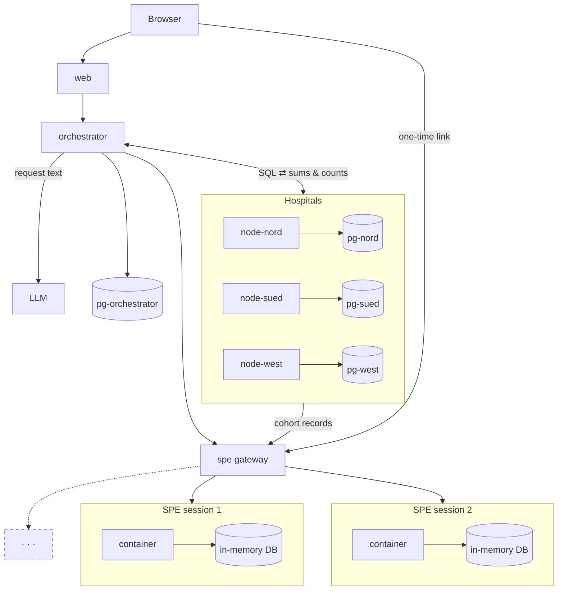

# Solution

Health Data Access Body for the European Health Data Space (EHDS), end to end.

- Request in: JSON, form or free text.
- Decision out: `REJECT`, `APPROVE_STATISTICAL` or `APPROVE_SPE`, plus articles of Regulation (EU) 2025/327.
- Statistics: federated queries over 3 hospital databases, small-cell rule, nothing patient-level leaves.
- Records: secure processing environment (SPE) as its own service. Researchers fit restricted models on the records; they never see or download them.
- Two views: Researcher (applicant) and Clinic (access body staff).

Run it: [SETUP.md](SETUP.md). Challenge: [CHALLENGE.md](CHALLENGE.md).

## Metrics

10 example requests, 3 runs each, LLM cache off. Every run decides again and writes its SQL again.
Time = submit to answer, wall clock, measured on client.
Model: `openai/gpt-5.6-luna`, for scoring and text (`ENDPOINT_TYPE=LOGPROB_LLM_PROVIDER_API`).

| Metric | Result | Target |
|---|---|---|
| Correct decisions | 10 of 10 | 10 of 10 |
| Correct numbers | 6 of 6 | 6 of 6 |
| Privacy leaks | 0 | 0 |
| Consistency (3 runs) | 10 of 10 | 10 of 10 |
| Slowest answer | 40.51 s | under 60 s |

| Request | Expected | Decision | Articles | Decision ok | Numbers ok | Consistent | Slowest | Leaks |
|---|---|---|---|---|---|---|---|---|
| R01 | APPROVE_STATISTICAL | APPROVE_STATISTICAL | 53, 69 | yes | yes | yes | 9.6 s | 0 |
| R02 | REJECT | REJECT | 54 | yes | n/a | yes | 6.7 s | 0 |
| R03 | APPROVE_STATISTICAL | APPROVE_STATISTICAL | 53, 69 | yes | yes | yes | 22.7 s | 0 |
| R04 | REJECT | REJECT | 54 | yes | n/a | yes | 12.3 s | 0 |
| R05 | APPROVE_SPE | APPROVE_SPE | 53, 66, 68, 73 | yes | yes | yes | 12.2 s | 0 |
| R06 | REJECT | REJECT | 54 | yes | n/a | yes | 8.9 s | 0 |
| R07 | APPROVE_STATISTICAL | APPROVE_STATISTICAL | 53, 69 | yes | yes | yes | 11.8 s | 0 |
| R08 | APPROVE_STATISTICAL | APPROVE_STATISTICAL | 53, 69 | yes | yes | yes | 40.5 s | 0 |
| R09 | APPROVE_STATISTICAL | APPROVE_STATISTICAL | 53, 66, 69 | yes | yes | yes | 40.0 s | 0 |
| R10 | REJECT | REJECT | 54 | yes | n/a | yes | 7.1 s | 0 |

Source: [eval/RESULTS_provider.md](eval/RESULTS_provider.md). Same check in app: Clinic, tab Benchmark (expand a row: expected values and benchmark results side by side).

Via OpenRouter, `qwen/qwen3-vl-30b-a3b-instruct` (scoring) with `deepseek/deepseek-v4-flash` (text) also reached 10/10, 6/6, 0 leaks and 10/10, slowest 18.04 s: [eval/RESULTS_openrouter.md](eval/RESULTS_openrouter.md).

### Check it yourself

Script: [eval/run_eval.py](eval/run_eval.py). Sends all requests through the API, compares with `requests/expected.json`, prints to console.

```bash
uv run python eval/run_eval.py              # app must run, see SETUP.md
```

Output, one line per run, every wrong value listed below its line:

```
R01 run 1  decision ok: APPROVE_STATISTICAL (expected APPROVE_STATISTICAL)  articles ok: 53, 69 (expected 53, 69)  numbers ok (9/9 groups)  13.5 s
R02 run 1  decision ok: REJECT (expected REJECT)  articles ok: 54 (expected 54)  numbers n/a  5.6 s
R05 run 1  decision ok: APPROVE_SPE (expected APPROVE_SPE)  articles ok: 53, 66, 68, 73 (expected 53, 66, 68, 73)  numbers ok (1/1 groups)  17.3 s
```

Then the metric table above. Also written to `eval/RESULTS_<endpoint>.md`: `openrouter`, `provider` or `local`, after the app's `ENDPOINT_TYPE`.

What each metric counts:

- Correct decisions: decision and articles match `expected.json` (extra Art. 67 or 71 ok). Per request. Request counts only if all 3 runs right. So 10 of 10 = all 30 runs right.
- Correct numbers: approved requests only. Every expected value found under its group (region, age band, ...). Layout and column names do not matter, values must match exactly. R05 (records): cohort size in SPE.
- Privacy leaks: statistical answers with patient ID, count below 10, failed release check, or opted-out patients visible to a hospital.
- Consistency: per request. All 3 runs same decision, articles and numbers.

## Local model (LOCAL_LLM)

Same benchmark, 10 requests x 3 runs, cache off, with `ENDPOINT_TYPE=LOCAL_LLM`: Qwen2.5-3B-Instruct (GGUF Q4_K_M),
llama.cpp server b11960, run natively on an Apple Silicon Mac (Metal GPU). Free, no key, nothing leaves the machine.

| Metric | Result | Target |
|---|---|---|
| Correct decisions | 5 of 10 | 10 of 10 |
| Correct numbers | 0 of 6 | 6 of 6 |
| Privacy leaks | 0 | 0 |
| Consistency (3 runs) | 10 of 10 | 10 of 10 |
| Slowest answer | 40.45 s | under 60 s |

| Request | Expected | Decision | Articles | Decision ok | Numbers ok | Consistent | Slowest | Leaks |
|---|---|---|---|---|---|---|---|---|
| R01 | APPROVE_STATISTICAL | APPROVE_STATISTICAL | 53, 69 | yes | no | yes | 10.1 s | 0 |
| R02 | REJECT | APPROVE_STATISTICAL | 53, 69 | no | n/a | yes | 33.6 s | 0 |
| R03 | APPROVE_STATISTICAL | APPROVE_STATISTICAL | 53, 69 | yes | no | yes | 38.4 s | 0 |
| R04 | REJECT | APPROVE_STATISTICAL | 53, 69 | no | n/a | yes | 7.7 s | 0 |
| R05 | APPROVE_SPE | APPROVE_STATISTICAL | 53, 66, 69 | no | no | yes | 10.5 s | 0 |
| R06 | REJECT | APPROVE_STATISTICAL | 53, 66, 69 | no | n/a | yes | 22.4 s | 0 |
| R07 | APPROVE_STATISTICAL | APPROVE_STATISTICAL | 53, 69 | yes | no | yes | 6.4 s | 0 |
| R08 | APPROVE_STATISTICAL | APPROVE_STATISTICAL | 53, 69 | yes | no | yes | 11.2 s | 0 |
| R09 | APPROVE_STATISTICAL | APPROVE_STATISTICAL | 53, 66, 69 | yes | no | yes | 40.4 s | 0 |
| R10 | REJECT | APPROVE_STATISTICAL | 53, 69 | no | n/a | yes | 14.8 s | 0 |

Source: [eval/RESULTS_local.md](eval/RESULTS_local.md).

What it shows:

- 3B model too small for the legal check. Never says a purpose is prohibited, so every request gets statistics.
- SQL from the 3B model mostly fails: hospitals refuse it at execution (HTTP 500), or the SQL guard still rejects it after 2 repairs (R09). Only R08 returns numbers: counts right, means wrong (5 of 9 groups match, the suppressed ones).
- Privacy holds anyway: 0 leaks. Guard, small-cell rule and release check do not depend on the model.
- Last minutes of this run shared the model server with a second benchmark, so times are an upper bound.
- In Docker on a Mac (CPU only, no Metal) the same model needs over 2 min per request. Natively with Metal: 4 to 40 s.

## Architecture



Hospital services check the SQL again, run it and send the orchestrator only sums and counts.
For records they push the cohort into the SPE gateway, which hands it to the session's own container; the orchestrator only gets counts.
Hospital databases hold only their own patients; opt-outs are removed in views.

| Part | Does | Built with |
|---|---|---|
| `pg-nord`, `pg-sued`, `pg-west` | One DB per hospital. First start loads only its own patients from the CSVs. Opted-out patients hidden in `v_*` views. Federation role: read-only, views only, 10 s timeout | PostgreSQL 16 |
| `node-*` | Hospital service. Checks every SQL again with same guard, runs the checked syntax tree (not raw text), returns partial sums and counts only, pushes SPE records only to the configured SPE instance, keeps own query log | FastAPI, psycopg 3 |
| `orchestrator` | Access body. Sign-in, roles, intake, decision, SQL generation with repair loop, federation, merge, release gate, SPE sessions, audit, dashboard, benchmark | FastAPI, httpx, psycopg 3 |
| `core/ehds_core` | Shared code: request schema, code vocabulary, SQL guard, articles, metrics | sqlglot 30.25, pydantic |
| `pg-orchestrator` | Request state, audit log (trigger blocks UPDATE, DELETE, TRUNCATE), LLM cache | PostgreSQL 16 |
| `spe` | SPE gateway. Starts one container per session, checks ingest tokens and one-time links, proxies the researcher's browser to that container, removes it after 2 minutes without activity | FastAPI, Docker SDK |
| `ehds-spe-<id>` | SPE session container, started by `spe`. Records in memory only. No published port, answers only with the gateway's per-session secret. Shows statistics, fits and runs restricted models. No endpoint returns a record | FastAPI, scikit-learn |
| `web` | One app, two roles | React 18, Vite, TypeScript, Tailwind, TanStack Query, Recharts |

## Pipeline

| Step | What happens | Time |
|---|---|---|
| Intake | Free text to form (LLM, JSON schema), form, example or JSON | before submit |
| Decision | 2 yes/no logprob heads + Art. 54 category head, in parallel. Legal order. Articles from fixed table. Reason text | about 1 s |
| Query | LLM writes PostgreSQL from the definitions. SQL guard checks it. Rejected SQL goes back to LLM, max 2 repairs | 1 to 3 s |
| Federation | Split SQL runs on 3 hospitals in parallel. All must answer or nothing released | under 0.1 s |
| Release | Partials summed with `Decimal`, outputs computed, small-cell rule, separate leak check | ms |
| SPE (instead) | Cohort SQL + requested record types. Orchestrator opens an SPE session; each hospital pushes only those rows straight into it with its own one-time token. Orchestrator gets counts only | about 1 s |

`REJECT` stops after decision. No hospital contacted. Audit log says so.

## Decision (logprobs)

Two yes/no questions, one token each, on the scoring model (`max_tokens=1`, reasoning off, top 5 `logprobs`):

- Art. 54 head: "Is the purpose of this request prohibited under Art. 54?" gives `p54`.
- Need head (applications only): "Does the applicant justify why anonymised statistics are not enough for the purpose?" gives `p_need`.

Combine:

- `P(REJECT) = p54`
- `P(SPE) = (1 - p54) * p_need`
- `P(STAT) = rest`

Order from the challenge: REJECT if `p54 >= 0.5`, else SPE if application and `p_need >= 0.5`, else STAT.
Health data request never gets SPE. Labels read from `top_logprobs` by text; variants (`no`, `No`, ` no`) summed.

Staff also see:

- Art. 54 category head (letters A to E).
- Flags when a score falls in the flagging band (Art. 54: 10 to 60 %, need: 20 to 80 %).
- For rejections: sentence attribution. Each sentence left out, request scored again, difference in percentage points.
- Override with written reason. Audited, request runs again with forced decision.

## Query layer (sqlglot)

LLM writes plain PostgreSQL against `v_*` views. Prompt has schema and full code list of the data
(13 ICD-10 condition codes, 4 encounter-only codes, 16 ATC, 4 LOINC, with plain-English names).
SQL guard (`core/ehds_core/sqlguard.py`):

1. Check. One SELECT. Only `v_*` views and CTEs. No DDL, DML, unknown functions. Group keys only `region`, `data_holder`, `sex` or `CASE` with literal labels. Outer aggregates only COUNT, SUM, AVG (+FILTER). No HAVING, MIN, MAX, median, window functions.
2. Split. Each patient lives in one hospital, so patient-level logic runs unchanged on each node. Only outer SELECT rewritten into additive parts (`AVG(x)` into `SUM(x)` + `COUNT(x)`, percent into two counts).
3. Merge. Parts of all hospitals summed per group with `Decimal`, outputs computed again. No integer division, no float rounding.
4. Release. Every requested group shown. Count below 10 shown as `<10`. Ratio or mean on count below 10 shown as `suppressed`. One decimal, half up. Mean never without its n. Separate leak check before release.

Suppression after merge, not per hospital. Per hospital would break totals (R08 Wien: 14 women spread over 3 hospitals).
Per-hospital parts stay inside the orchestrator process, never stored, never shown.

## Privacy controls

| Layer | Control |
|---|---|
| Hospital DB | Opt-outs removed in views. Federation role reads views only, read-only |
| Hospital service | Checks SQL again, runs checked syntax tree, only COUNT and SUM parts leave |
| SQL guard | Rules above. Attack tests in `tests/test_sqlguard.py` |
| Release gate | Small-cell rule, all groups, patient ID scan, separate leak check |
| LLM | Only request text sent. Patient data never leaves the containers |
| SPE | Own container per session, records in memory, no published port, reachable only through the gateway with a one-time link; removed after 2 minutes without activity. The gateway holds the Docker socket (root on the host, acceptable for a demo). Hospitals push only requested record types straight in, one-time token per hospital; orchestrator sees counts only. No endpoint returns records: statistics only for groups of 10 or more, no min/max. Models restricted: 50+ patients, tree depth at most 3, 20+ patients per leaf, 100 runs per model. No record download: the "Download records" button and its URL return 403 and write `spe.download_blocked` to the audit log, counted on the dashboard |
| Access | Separate Researcher and Clinic accounts. scrypt hashes. Server-side sessions, HttpOnly SameSite=Strict cookie. Role check on every endpoint. Researcher sees own requests only. 5 failed sign-ins lock account 5 min |
| Audit | Append-only log: every step, LLM usage, hospital query, sign-in, override, SPE opened, model fitted and run |

## Secure processing environment

- For `APPROVE_SPE` (R05): LLM writes cohort query and lists record types the request names.
- Orchestrator asks the SPE gateway for a session. The gateway starts a fresh container for it and returns one ingest token per hospital. This first session only counts the cohort for the permit and is removed right after sealing.
- Each hospital runs the cohort query, pushes its part (only those record types) straight into the session, and returns counts. Address of the SPE is fixed in the hospital config, so nobody can redirect the records.
- SPE seals the session: ingest tokens die, orchestrator gets counts (R05: 1,152 patients).
- Researcher: permit card, "Download records" (refused by the server with 403, message shown, attempt audited), "Open secure processing environment (SPE)". The button starts a fresh container ("Provisioning container…"), the hospitals fill it again with the same cohort query, and a new tab opens on a one-time link (2 min). The gateway swaps the link for its own HttpOnly cookie, shows a short redirect countdown and forwards the tab to the session's container. After 2 minutes without activity the container and its records are gone.
- SPE page, no free code:
  1. Note: records cannot be viewed, queried or downloaded.
  2. Statistics per table and column, only for groups of 10 or more.
  3. Fit a model: logistic regression, decision tree or ridge regression; pick target (y) and inputs (x). Inputs are one row per patient, derived only from the copied record types (e.g. "takes metformin", "latest HbA1c").
  4. Download fitted model (shown after a fit): held-out metrics, weights or importances, file as pickle or joblib.
  5. Run fitted model (shown after a fit): type in values, get a prediction (Yes/No with probability, or a number). 100 runs per model.
- Every opening, fit, run and model download lands in the orchestrator's audit log (metadata only).

## Models

| Use | Model |
|---|---|
| Decision heads, category head, attribution | `LLM_SCORE_MODEL`, measured with `openai/gpt-5.6-luna` (default for OpenRouter: `qwen/qwen3.8-27b`). On OpenRouter, hosts without logprobs are skipped: scoring calls fall back to one that returns them, learned on the first empty reply |
| SQL, cohort spec, free text to form, reason text | `LLM_TEXT_MODEL`, JSON-schema output |
| SQL parsing and rewriting | sqlglot 30.25 |
| Models inside the SPE | scikit-learn: logistic regression, decision tree, ridge regression |

Switch with `ENDPOINT_TYPE` in `.env` (see [SETUP.md](SETUP.md)):

| `ENDPOINT_TYPE` | Request |
|---|---|
| `OPENROUTER` (default) | OpenAI format plus `reasoning_effort: none` and 5 `top_logprobs`; scoring falls back to a logprob-capable host (`require_parameters`) |
| `LOGPROB_LLM_PROVIDER_API` | same request, for any other provider (no OpenRouter defaults) |
| `LOCAL_LLM` | same plain request, against local llama.cpp with Qwen2.5-3B-Instruct (GGUF) |

No embeddings, no RAG: data has no free text, code list fits in prompt.

## Repository

```
core/ehds_core/   shared: schema, vocabulary, SQL guard, articles, metrics
node/             hospital service
orchestrator/     access body service (decision, SQL, federation, release, audit)
spe/              SPE gateway and session containers (training page, restricted models)
db/               init scripts for hospital and orchestrator databases
web/              React frontend
eval/             metric runner and results
tests/            unit tests (SQL guard attacks, metrics, SPE limits)
wiki/             legal reference the prompts are based on (not loaded at runtime)
data/ requests/   challenge data, unchanged
```

## Demo (2 min)

1. Researcher: "Describe in your words", type request, "Fill request from description", submit. Live steps, result table with `<10` and `suppressed` cells.
2. Examples tab: R08. Five regions suppressed, `?` explains small-cell rule.
3. R02 (insurer): rejected, Art. 54. Clinic view: scoring heads, category, sentence attribution.
4. R05: records approved, 1,152 patients. "Download records": blocked, message shown, attempt in the audit log. "Open secure processing environment (SPE)": new tab with statistics, fit a model, download it, run it.
5. Clinic: R05 detail. Release tab shows permit and SPE session; Audit tab shows SPE opened, model fitted and run.
6. Clinic tabs: Dashboard, Logs (requests, audit log, hospital query logs), Benchmark (all 30 runs).

## Limits

- New requests need the LLM endpoint. If it is down, new requests fail. Cached ones still work.
- Each patient lives in exactly one hospital here. Real federation needs cross-hospital pseudonym linkage first.
- Two demo accounts, set in `.env`. No user management. `COOKIE_SECURE=true` behind HTTPS.
- SPE offers three restricted models, no free code. Model output (metrics, weights, predictions) leaves; records never do.
- Statistics: counts, shares, means. Medians and percentiles refused: cannot merge across hospitals without sharing values.
